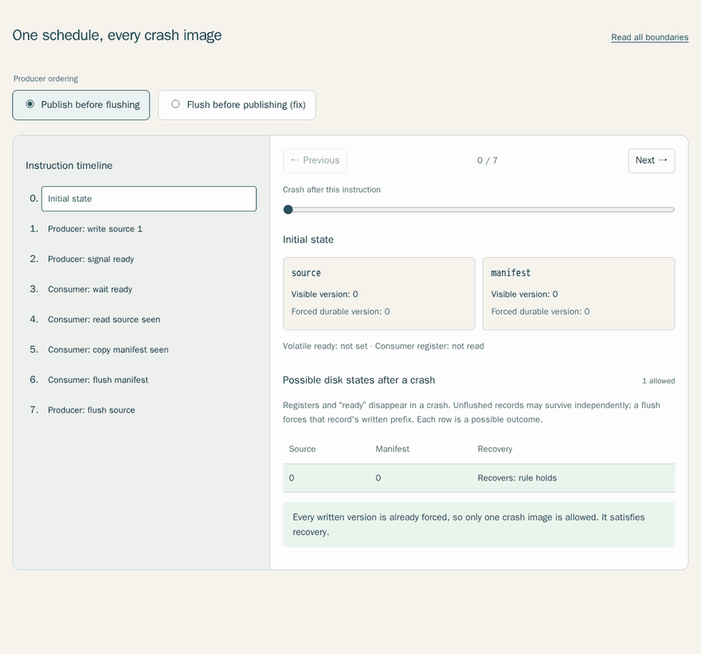

# Durability Debt

Durability Debt is an interactive model of one crash-consistency bug, in which a producer makes a write visible before it is durable, a consumer builds on it and saves the result, and a crash leaves that result on disk without the input it came from.

```text
Producer                       Consumer
write source = 1
signal ready ----------------> wait ready
                               read source = 1
                               copy manifest from read
                               flush manifest
                 CRASH before producer flushes source
```

The producer writes `source = 1` and signals "ready" before flushing it, so the consumer can read the new source, write `manifest = 1` and flush that. A crash before the producer's flush can then leave `manifest = 1` and `source = 0` on disk, which breaks the recovery rule `manifest <= source`. When the producer flushes the source before signaling (`write source; flush source; signal ready`), the model has no bad crash state.



The [lesson page](https://mottopanikeiku.github.io/durability-debt/) steps through either ordering one instruction at a time, and after each instruction it lists every disk state a crash could leave and marks the ones that break recovery. It works offline, and the tables are plain HTML if JavaScript is off.

All of it is generated by a small explorer, which finds five schedules and one bad crash outcome in 34 crash checks for the unsafe ordering when it allows at most two preemptions. Whether a single test run sees the bug depends on the schedule. A producer-first trace flushes the source before the consumer reads it and so never sees the bug, while a consumer-first trace finds it.

## Building the page

The code needs Python 3.11 or newer and has no dependencies:

```sh
python3 tools/build_site.py --output _site
python3 tools/demo.py
python3 -m unittest discover -s tests -v
```

The build writes the page to `_site/index.html`, which opens directly in a browser, and the [model notes](docs/model.md) cover the instructions, scheduling and saved results.

## Related work

The same failure class is studied on real persistent memory and file systems in [PMRace](https://github.com/yhuacode/pmrace), [DURINN](https://www.usenix.org/system/files/osdi22-fu.pdf), [PerSeVerE](https://plv.mpi-sws.org/persevere/) and [ALICE](https://github.com/madthanu/alice). This repo uses a tiny integer-record model so that the bug is easy to see, and it is released under the MIT license.
